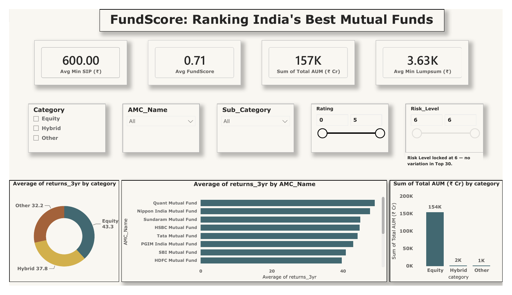
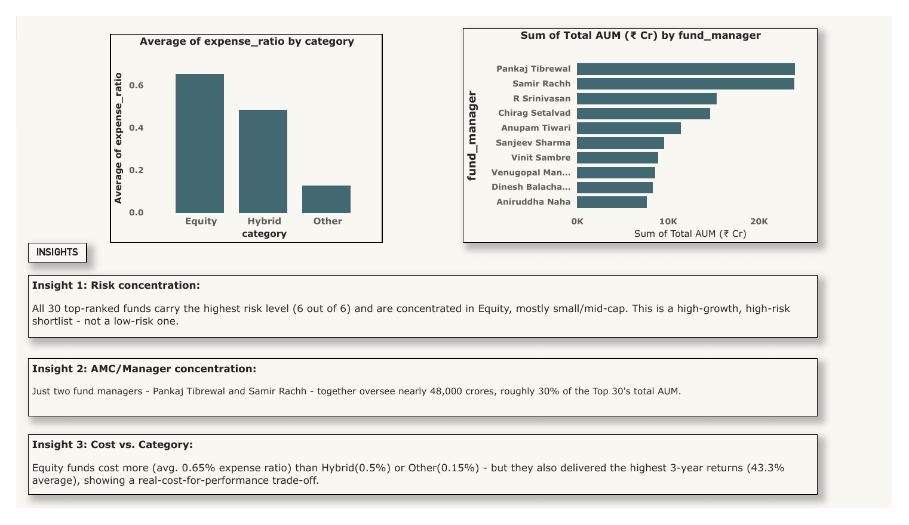

# FundScore — Mutual Fund Recommendation System

A Python scoring model that ranks 793 Indian mutual funds and picks a Top 30 shortlist, with a two-page Power BI dashboard to explore the results.

Project 2 of 8 · Built during my Data Analyst Internship at Labmentix (Aug–Nov 2026).




## The business question

There are hundreds of mutual funds, and most investors don't have time to compare them all. Picking the fund with the highest return alone is risky, because cost and track record matter too.

**Goal:** turn a messy list of funds into a Top 30 shortlist that balances good returns, low cost and a sensible fund age.

## How the score works

```
FundScore = (0.5 × 3-year return + 0.3 × low cost + 0.2 × age score) × positive 1-year return
```

| Part | Weight | What it rewards |
|---|---|---|
| 3-year return | 50% | Strong long-term performance |
| Low cost (inverted expense ratio) | 30% | Cheaper funds, since fees eat into returns every year |
| Age score | 20% | Funds near the typical age (10 years): not brand new, not outdated |
| Positive 1-year return | Gate | A fund with a negative 1-year return scores **0** and is removed |

All three factors are first scaled to 0–1 with MinMaxScaler, so a big-number column like returns doesn't dominate a small-number column like expense ratio.

**Is the ranking stable?** I tested other weights (40/40/20) and **9 of the Top 10 stayed the same**. I also tested a risk penalty based on volatility. Even at 40% weight, the Top 10 barely changed.

## Key findings (Top 30)

- **Equity dominates.** 24 of the 30 funds are Equity funds, mostly small-cap and mid-cap.
- **One fund house leads.** Quant Mutual Fund has **9 of 30** spots, and ICICI Prudential has 5.
- **#1 fund:** Quant Small Cap Fund, with a FundScore of 0.926 and the highest 3-year return in the data (**71.4%**).
- **Higher return costs more.** Equity averages a **43.3%** 3-year return at 0.65% cost. Hybrid averages 37.8% at 0.49%, and Other averages 32.2% at 0.13%.
- **Money is concentrated.** Equity holds **₹1,54,461 crore** of the Top 30's ₹1,57,263 crore AUM (assets under management). Two managers, Pankaj Tibrewal and Samir Rachh, oversee nearly ₹48,000 crore between them.
- **Easy to start.** The Top 30 need an average minimum SIP of **₹600** and an average minimum lump sum of ₹3,630.

## ⚠️ The main limitation

**All 30 funds sit at the highest risk level (6 out of 6).** The score rewards return and cost, but not low risk. In this data, high returns and high risk go together so closely that no sensible weighting gave a "high return, low risk" list.

So this Top 30 is a **growth shortlist, not a safe one.** A risk-averse first-time investor should look further down the full ranking, or use this list for only the growth part of a portfolio.

## How it works

1. **Clean the data** (814 funds, 20 columns):
   - Turned "-" values in the risk ratio columns (Sharpe, Sortino, alpha, beta, SD) into proper blanks and converted them to numbers.
   - Flagged 38 rows that share a scheme name with another fund, instead of deleting them.
   - Dropped 21 funds with no 3-year return (2.6%), since the score needs it. This left **793 funds**.
   - Filled missing risk ratios with the median of the fund's own category.
2. **Explore** the returns, risk levels and fund ages with summary statistics and charts.
3. **Score and rank** all 793 funds with the formula above, and test the weights.
4. **Export the Top 30** to a formatted Excel file (bold header, frozen top row).
5. **Build the Power BI dashboard:**

| Page | What it shows |
|---|---|
| **1. Overview** | KPI cards (average minimum SIP, average FundScore, total AUM, average minimum lump sum), 5 slicers, 3-year return by category and by AMC, AUM by category |
| **2. Insights** | Expense ratio by category, AUM by fund manager, and three written insight cards |



## Other limitations

- **Smaller dataset than expected.** The brief mentioned 2,500+ schemes, but the data has 814.
- **One snapshot.** The returns are from a single point in time. Past returns do not guarantee future returns.
- **Not financial advice.** This is a learning project, not an investment recommendation.

## Run it yourself

**Notebook:** open [`notebooks/Mutual_Funds.ipynb`](notebooks/Mutual_Funds.ipynb) in Google Colab and click **Run all**. The data loads directly from this repo, so no setup is needed.

**Dashboard:** open [`dashboard/Mutual_Funds_Dashboard.pbix`](dashboard/Mutual_Funds_Dashboard.pbix) in Power BI Desktop, or see the [PDF export](docs/Dashboard_Export.pdf).

## Project files

| File | What it is |
|---|---|
| `notebooks/Mutual_Funds.ipynb` | Full analysis: cleaning, statistics, scoring, ranking and written answers |
| `data/comprehensive_mutual_funds_data.csv` | Raw data (814 funds) |
| `output/Top_30_Mutual_Funds.xlsx` | Formatted Top 30 shortlist |
| `output/top_30_funds.csv` | Top 30 as CSV (the dashboard's data source) |
| `dashboard/Mutual_Funds_Dashboard.pbix` | The Power BI dashboard |
| `docs/Dashboard_Export.pdf` | Both dashboard pages as a PDF |

## How I built it

I used AI to help write the Python code. I designed the scoring formula, tested the weights, checked every figure against the data, and wrote the findings.

## Author

**Vipsa Patel** — Data Analyst Intern, Labmentix · [LinkedIn](https://www.linkedin.com/in/vipsapatel)
